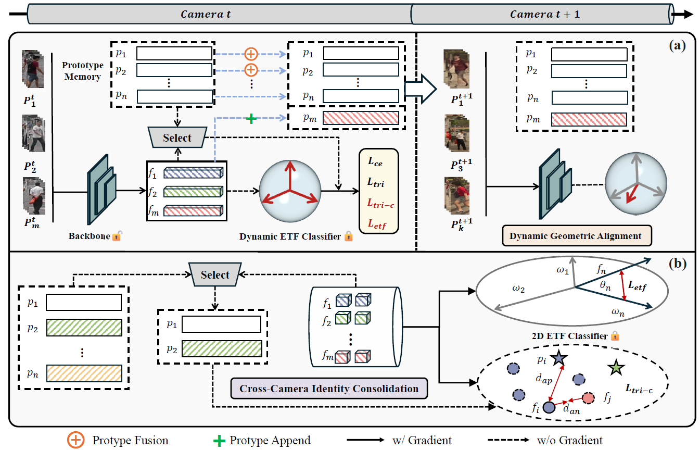
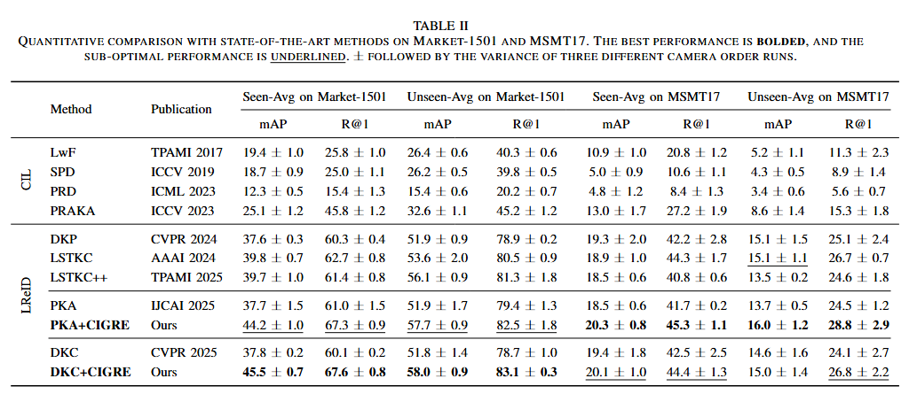

# [TPAMI] Camera-Incremental Person Re-Identification via Geometric Representation Evolution (CIGRE)

This repository contains the implementation of **Camera-Incremental Person
Re-Identification via Geometric Representation Evolution**.



## Task Setting

Unlike conventional lifelong ReID,
the identity spaces across stages may overlap: a new camera can observe both
previously seen identities from new viewpoints and previously unseen
identities. The primary benchmark follows supervised ReID.  The model receives one camera at a time and cannot access historical images. The default Market-1501 order is `cam0 -> cam1 -> cam2 -> cam4 -> cam5`, with `cam3` held out for evaluation.

## Installation

```bash
conda create -n CIGRE python=3.10
conda activate CIGRE
pip install torch==1.13.1+cu117 torchvision==0.14.1+cu117 torchaudio==0.13.1 --extra-index-url https://download.pytorch.org/whl/cu117
pip install -r requirement.txt
```

## Prepare datasets

Download [Market-1501](https://drive.google.com/file/d/0B8-rUzbwVRk0c054eEozWG9COHM/view)
and [MSMT17](http://www.pkuvmc.com/dataset.html), then arrange them as follows:

```text
<DATA_ROOT>/
├── market1501/
│   └── Market-1501-v15.09.15/
│       ├── bounding_box_train/
│       ├── bounding_box_test/
│       ├── query/
│       └── ...
└── MSMT17_V2/
    ├── bounding_box_train/
    ├── bounding_box_test/
    ├── query/
    └── .../
```

## Quick start

Training and evaluation:

```bash
python continual_train.py --data-dir /path/to/datasets
```

Evaluation from a checkpoint:

```bash
python continual_train.py --data-dir /path/to/datasets  --test_folder /path/to/checkpoints --evaluate
```

## Results

The following results were obtained on an NVIDIA 4060 GPU:



## Citation

If you find this code useful, please cite our paper:

```bibtex
@article{ye2027cigre,
  title   = {Camera-Incremental Person Re-Identification via Geometric Representation Evolution},
  author  = {Ye, Mang and Zhang, Shipeng and Shi, Wuxuan and Lu, Zhijie and Li, He and Gao, Xingyu},
  journal = {IEEE Transactions on Pattern Analysis and Machine Intelligence},
  year    = {2027}
}
```

## Acknowledgements

This code is based on the PyTorch implementations of
[PKA](https://github.com/joyner-7/IJCAI2025-PKA) and
[DKP](https://github.com/zhoujiahuan1991/CVPR2024-DKP).
